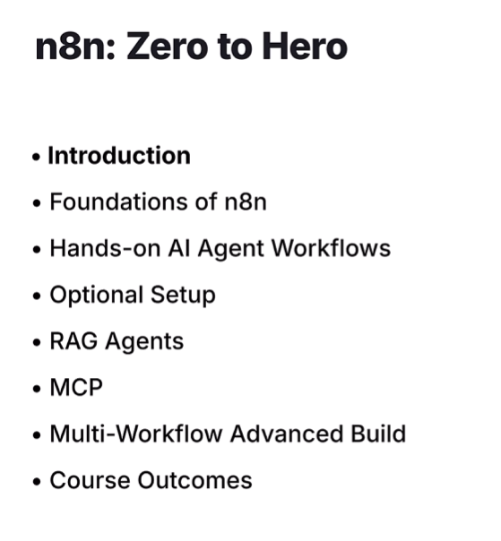

# Agenda

Course modules at a glance

| Module | Focus | Outcome |
| - | - | - |
| Introduction & Setup | n8n basics, Playground, API keys | Run your first workflow and connect to OpenAI/Anthropic |
| Nodes & Data Flow | Node types, data formats, execution model | Design predictable workflows and inspect node data |
| AI Agents (Single & Multi) | Email agents, research agents, multi-agent patterns | Build agents that draft responses and conduct research |
| RAG & Vector DBs | Indexing, Pinecone integration, knowledge retrieval | Build context-aware customer support agents |
| Multimodal Workflows | Text/image/video pipelines using Veo3 & Seedance | Create creative automations (images, videos) |
| Production Patterns | MCPs, sub-workflows, retries & error handling | Design maintainable, scalable automation systems |
| Deployment (optional) | Self-hosting with Docker, local LLMs, EC2 hosting | Deploy n8n Playground using Ollama and EC2 |

---

# Foundation of n8n

[Foundation Notes](Foundation.md)

- What is n8n
- Nodes: the building blocks
    - Trigger
    - Action
- Workflow
- Branching and parallel paths
- Memory for AI agents
    - Context memory (short-term)
    - Long-term searchable memory (RAG)
- Inputs and outputs for nodes
    - Schema
    - Table
    - JSON
- Expressions and dynamic fields
    - Node fields accept
        - Static
        - Expression
    - Data types used in n8n
        - String
        - Number
        - Boolean
        - Array
        - Object
- Community nodes

# n8n Agent

[n8n Agent](n8n_agent.md)

- SignUp
- Demo KK Keyspace
- Trigger Node
    - Chat Node
- Action Node
    - AI Agent
        - Chat Model
            - OpenAI
        - Tools
            - Gmail
        - Memory
            - Simple Memory
- Example
    - Email Assistance agent

# n8n Local setup
- local host npx
- docker setup
- ec2 setup

# MCP
- MCP Client
- MCP Server Trigger
    - MCP Straming Server
